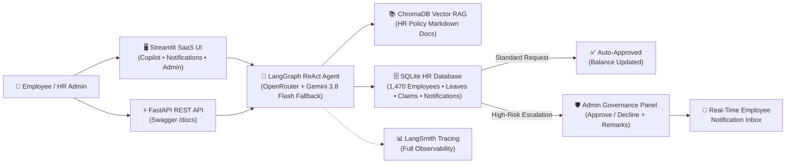

# 🤖 PeopleOps Copilot

> **Autonomous HR Policy RAG, Leave & Expense Automation Assistant with Human-in-the-Loop Admin Governance**


---

## 📌 Overview

**PeopleOps Copilot** is an end-to-end agentic HR platform that combines **Retrieval-Augmented Generation (RAG)**, **tool-calling autonomous database actions**, and **Human-in-the-Loop (HITL) Admin Governance**.

Employees can ask HR policy questions with exact section-level citations, inspect live leave balances, submit leave requests, and file expense reimbursement claims across a **1,470-employee SQLite HR database**. Standard requests are auto-approved instantly, while **High-Risk requests** are automatically routed to an **HR Admin Governance Console** where managers can approve or decline with remarks—triggering **real-time notifications** back to the employee's inbox.

---

## 🏗️ System Architecture



---

## ✨ Key Features

| Feature | Description |
| :--- | :--- |
| **📚 Policy Lookup (RAG with Citations)** | Searches official Leave, Expense, and Medical/Wellness markdown policies via ChromaDB vector search and returns inline citations (e.g., `[employee_leave_policy.md, Sec 1]`). |
| **🗄️ Live HR Database (1,470 Employees)** | Seeded with IBM HR Analytics-inspired records (`EMP-101` to `EMP-1570`), searchable directly from the UI sidebar with live leave balance progress bars. |
| **🧠 Conversation Memory & Session Context** | Preserves recent chat history and active employee session context for natural multi-turn follow-up queries. |
| **🛡️ HR Admin Governance Console** | Dedicated Admin Panel with live KPI cards, High-Risk escalation queues, manager remarks, one-click **Approve / Decline**, automatic leave balance deduction, and filterable audit logs. |
| **🔔 Real-Time Employee Notifications** | Admin approvals and declines automatically push timestamped notifications with manager remarks to the employee's Notifications inbox with unread badge counters. |
| **⚡ Resilient Dual-LLM Routing** | Primary OpenRouter (`openrouter/free`) with automatic failover to Google Gemini (`gemini-3.8-flash`) via `ResilientLLM`. |
| **📊 Always-On LangSmith Observability** | Automatic tracing of every agent reasoning step, RAG retrieval, and SQLite tool invocation in LangSmith. |
| **🔌 FastAPI REST Backend** | Production-ready REST API with interactive Swagger UI (`/docs`) for integrating with external portals, Slack/Teams bots, or mobile apps. |

---

## ⚖️ Automated Policy & Escalation Rules

| Request Type | Auto-Approved | High-Risk Escalation (Routed to Admin Panel) |
| :--- | :--- | :--- |
| **Leave Application** | `≤ 3` consecutive days (if balance available) | `> 3` consecutive days (`Pending Manager Approval`) |
| **Internet / Home Office Claim** | `≤ 2,000 BDT` | `> 2,000 BDT` (Exceeds category cap) or `> 5,000 BDT` |
| **Client Meals Claim** | `≤ 4,000 BDT` | `> 4,000 BDT` (Exceeds category cap) or `> 5,000 BDT` |
| **General Expense Claim** | `≤ 5,000 BDT` | `> 5,000 BDT` (`High-Risk Escalation`) |

---

## 📂 Project Structure

```text
PeopleOps-Project/
├── peopleops-copilot/
│   ├── .streamlit/
│   │   └── config.toml          # Custom Indigo & Soft Slate SaaS theme
│   ├── data/
│   │   ├── chroma_db/           # Persisted Chroma vector embeddings (auto-generated)
│   │   ├── db/hr_system.db      # SQLite database (1,470 employees + records + notifications)
│   │   ├── policies/            # Official HR policy markdown documents
│   │   │   ├── employee_leave_policy.md
│   │   │   ├── expense_reimbursement_rules.md
│   │   │   └── medical_wellness_benefits.md
│   │   └── seed_db.py           # Database schema & demo seeder script
│   ├── src/
│   │   ├── tools/hr_tools.py    # LangChain DB tools + Admin & Notification helpers
│   │   ├── agent.py             # LangGraph ReAct agent with memory & session context
│   │   ├── llm.py               # ResilientLLM (OpenRouter + Gemini) & LangSmith config
│   │   └── rag.py               # Markdown header chunking, ChromaDB & cited RAG
│   ├── app.py                   # Streamlit SaaS UI (Fixed Top Navbar: Copilot, Notifications, Admin)
│   ├── api.py                   # FastAPI REST backend with Swagger docs
│   ├── .env.example             # Environment variable template
│   ├── requirements.txt         # Python dependencies
│   └── README.md                # Module documentation
├── requirements.txt             # Root Python dependencies
└── README.md                    # Project overview
```

---

## 🚀 Quick Start

### 1. Clone the Repository
```bash
git clone https://github.com/rjraj111/PeopleOps-Project.git
cd PeopleOps-Project
```

### 2. Create & Activate Virtual Environment
```bash
python -m venv venv

# Windows (PowerShell)
venv\Scripts\activate

# macOS / Linux
source venv/bin/activate
```

### 3. Install Dependencies
```bash
cd peopleops-copilot
pip install -r requirements.txt
```

### 4. Configure Environment Variables
Copy `.env.example` to `.env` inside `peopleops-copilot/` and add your API keys:
```bash
cp .env.example .env
```
```env
GOOGLE_API_KEY="your_google_api_key"
OPENROUTER_API_KEY="your_openrouter_api_key"

# Optional: LangSmith Observability (auto-enabled when key is present)
LANGSMITH_API_KEY="your_langsmith_api_key"
LANGCHAIN_TRACING_V2=true
LANGCHAIN_PROJECT="PeopleOps-Copilot"
```

### 5. Seed the HR Database
```bash
python data/seed_db.py
```

### 6. Run the Application
- **Launch Streamlit SaaS UI** (http://localhost:8501):
  ```bash
  streamlit run app.py
  ```
- **Launch FastAPI Backend & Swagger Docs** (http://127.0.0.1:8000/docs):
  ```bash
  uvicorn api:app --reload
  ```

---

## 🔌 REST API Endpoints (`api.py`)

| Method | Endpoint | Description |
| :--- | :--- | :--- |
| `GET` | `/` | Health check for the PeopleOps Copilot API |
| `GET` | `/employee/{employee_id}` | Fetch live employee profile & leave balances |
| `POST` | `/chat` | Send a natural-language query/action to the LangGraph agent |
| `GET` | `/admin/pending` | List all pending High-Risk leave & expense escalations |
| `POST` | `/admin/review` | Approve or decline a pending leave/expense request with remarks |

---

## 🎯 Demo Walkthrough

1. **Cited Policy Q&A:** Ask *"How many annual leave days am I entitled to and can unused days be carried forward?"* to see exact `[employee_leave_policy.md, Sec 1]` citations.
2. **Auto-Approved Action:** Submit a 2-day Casual Leave for `EMP-101` and watch the live leave balance progress bar decrease immediately.
3. **High-Risk Escalation:** Submit a 5-day Annual Leave or a 7,500 BDT Client Meals claim—notice the **Admin Panel** badge increment in the fixed top header.
4. **Human-in-the-Loop Governance:** Switch to **🛡️ Admin Panel**, add a manager remark, and click **Approve** or **Decline**.
5. **Real-Time Notification:** Switch to **🔔 Notifications** to view the employee's instant decision alert and inspect full execution traces in **LangSmith**.
